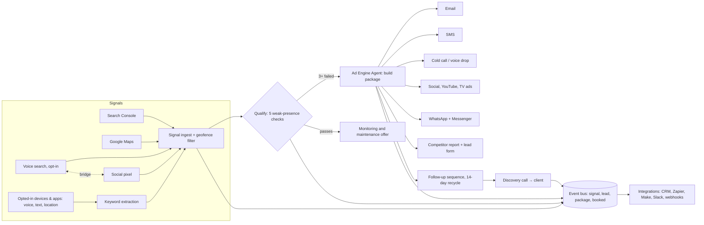

# Architecture

## Components

| Layer | Dashboard (`src/app.html`) | Server (`server/index.js`) |
| --- | --- | --- |
| Ingest | `Demo.ingest()` / `ProspectAI.pushSignal()` | `POST /api/signals` |
| Geofence | Canvas circle, haversine-equivalent screen distance | `insideAnyFence()` with haversine miles |
| Qualify | `Demo.process()`, configurable criteria and threshold | `qualify()` in `agent.js` |
| Package | templates + package modal | `agent.js` → `channels/` (SendGrid, Twilio, Meta, WhatsApp, Lob) |
| Event bus | `dispatch()` → listeners, `window` events | `bus.js` → SSE stream + signed webhooks |

## Production path

1. Replace the simulated signal generator with Search Console query exports by city, plus Places Text Search for each keyword.
2. Store prospects and packages in Postgres with a `(place_id, keyword)` uniqueness key so each business gets one package per cycle.
3. Run the follow-up sequence on a job queue (BullMQ, Cloud Tasks) keyed by package id and day offset.
4. Done: the dashboard already streams from `/api/stream` when served by the server.
