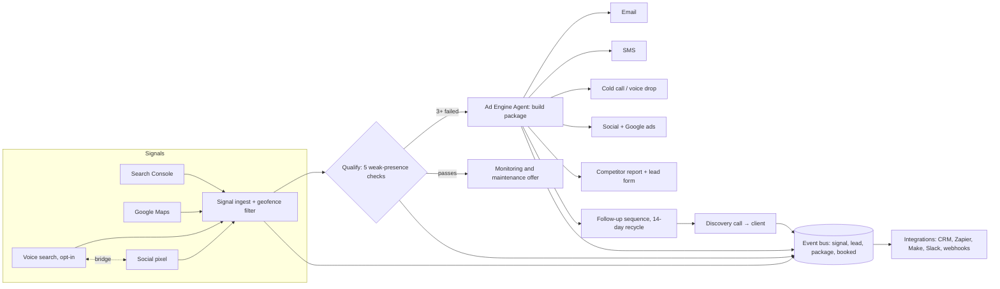

# Architecture

## Components

| Layer | Dashboard (`src/app.html`) | Server (`server/index.js`) |
| --- | --- | --- |
| Ingest | `spawn()` / `ProspectAI.pushSignal()` | `POST /api/signals` |
| Geofence | Canvas circle, haversine-equivalent screen distance | `insideAnyFence()` with haversine miles |
| Qualify | `scoreBiz()`, configurable criteria and threshold | `qualify()` |
| Package | `agentProcess()` + templates | `POST /api/outreach` (SendGrid, Twilio) |
| Event bus | `emit()` → listeners, `window` events, integrations | `publish()` → registered webhooks |

## Production path

1. Replace the simulated signal generator with Search Console query exports by city, plus Places Text Search for each keyword.
2. Store prospects and packages in Postgres with a `(place_id, keyword)` uniqueness key so each business gets one package per cycle.
3. Run the follow-up sequence on a job queue (BullMQ, Cloud Tasks) keyed by package id and day offset.
4. Feed the dashboard through Server-Sent Events from the event bus instead of the in-page simulator.
